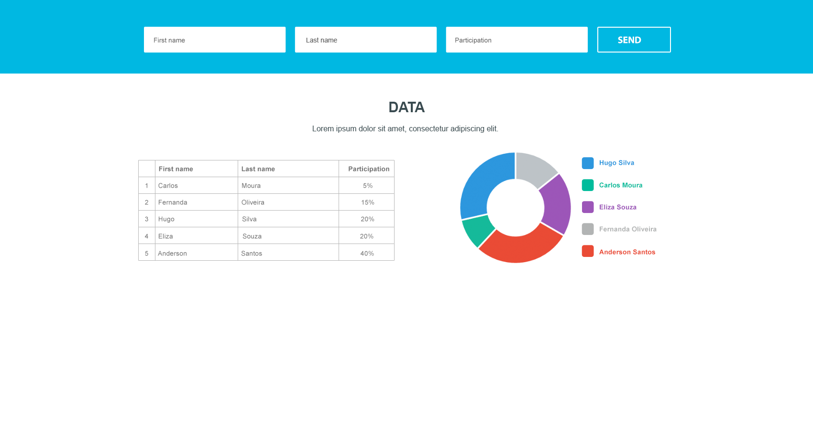

# Fullstack Challenge

A web app to register people and their percentage of participation. The data is shown in a table and in a donut chart. The frontend is built with React and the backend is a REST API built with Django.



## Tech stack

**Frontend**
- React 19 + TypeScript
- Vite
- Recharts (donut chart)
- CSS Modules

**Backend**
- Python 3.12
- Django + Django REST Framework
- PostgreSQL
- django-cors-headers

## Project structure

```
fullstack-challenge/
├── backend/                  # Django REST API
│   ├── config/               # project settings and root URLs
│   └── participants/         # model, serializer, views and URLs for participants
├── frontend/                 # React app
│   └── src/
│       ├── App.tsx           # state and API calls
│       ├── types.ts          # shared TypeScript types
│       └── components/       # form, table and chart
└── docs/                     # layout reference
```

## Prerequisites

- [Python 3.12+](https://www.python.org/)
- [Node.js 20+](https://nodejs.org/) (developed with Node 24)
- [PostgreSQL 17](https://www.postgresql.org/) (on macOS: `brew install postgresql@17`)

## How to run

The backend and the frontend run at the same time, each one in its own terminal.

### 1. Database

Start PostgreSQL and create the database:

```bash
brew services start postgresql@17   # macOS with Homebrew
createdb challenge
```

The database connection is read from environment variables. If a variable is not set, the default value is used:

| Variable | Default |
|---|---|
| `DB_NAME` | `challenge` |
| `DB_USER` | `pete` |
| `DB_PASSWORD` | *(empty)* |
| `DB_HOST` | `localhost` |
| `DB_PORT` | `5432` |

Set `DB_USER` and `DB_PASSWORD` to match your local PostgreSQL user, for example:

```bash
export DB_USER=your_user
export DB_PASSWORD=your_password
```

Run these `export` commands in the same terminal you use for the backend, before the commands below.

### 2. Backend

```bash
cd backend
python3 -m venv .venv
source .venv/bin/activate          # on Windows: .venv\Scripts\activate
pip install -r requirements.txt
python manage.py migrate
python manage.py runserver
```

The API runs at **http://localhost:8000/participants/**.

### 3. Frontend

In another terminal:

```bash
cd frontend
npm install
npm run dev
```

Open **http://localhost:5173** in the browser.

## Features

- Register a participant with first name, last name and participation
- Table and donut chart that update as soon as a participant is added or removed
- Data saved in PostgreSQL, so it stays after the page is reloaded
- Remove a participant with the trash button that appears when hovering a table row
- Highlighted table row on hover
- Subtitle with the number of participants and the total participation
- Chart shows a gray "Sem dados" slice while the list is empty

### Validation

- All form fields are required
- Participation must be between 0 and 100
- The sum of all participations cannot exceed 100%
- Errors returned by the API are shown under the form and disappear after 5 seconds

## API

Base URL: `http://localhost:8000`

| Method | Endpoint | Description | Success |
|---|---|---|---|
| `GET` | `/participants/` | List all participants | `200 OK` |
| `POST` | `/participants/` | Create a participant | `201 Created` |
| `DELETE` | `/participants/<id>/` | Remove a participant | `204 No Content` |

### Create a participant

Request:

```json
{
  "firstName": "Carlos",
  "lastName": "Moura",
  "participation": 5
}
```

Response (`201 Created`):

```json
{
  "id": 1,
  "firstName": "Carlos",
  "lastName": "Moura",
  "participation": 5.0
}
```

### Errors

Invalid data returns `400 Bad Request` with a JSON object. Each key is a field, and its value is a list of messages:

```json
{
  "participation": [
    "Total participation cannot exceed 100%. Only 40% is still available."
  ]
}
```
